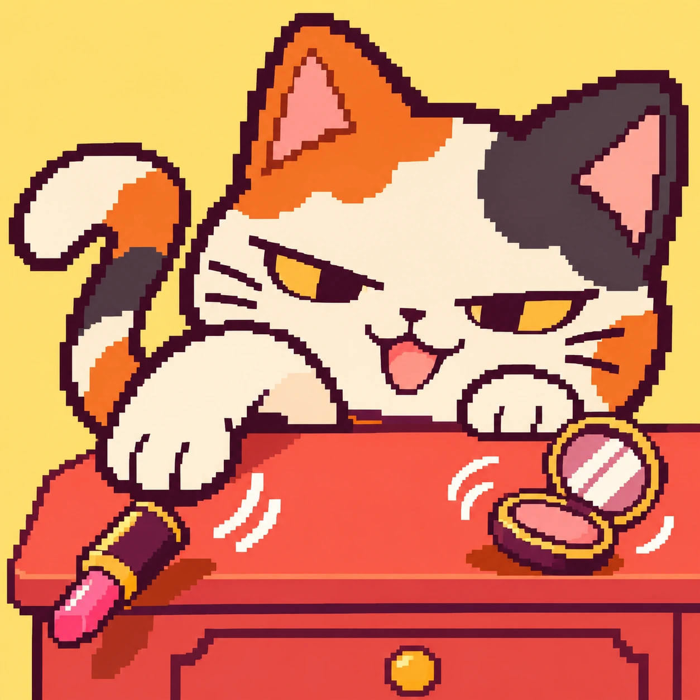
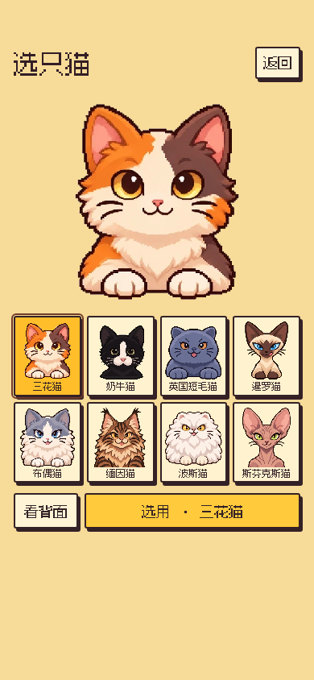
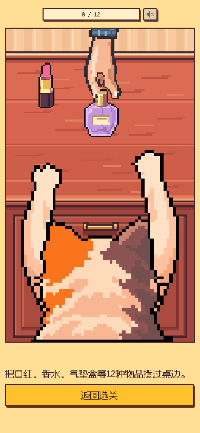
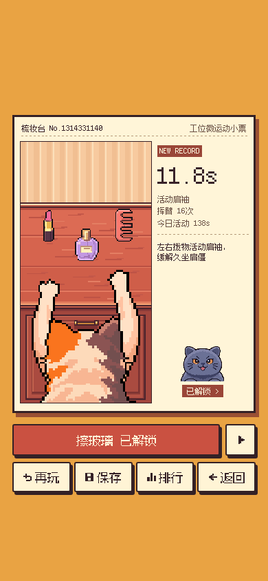
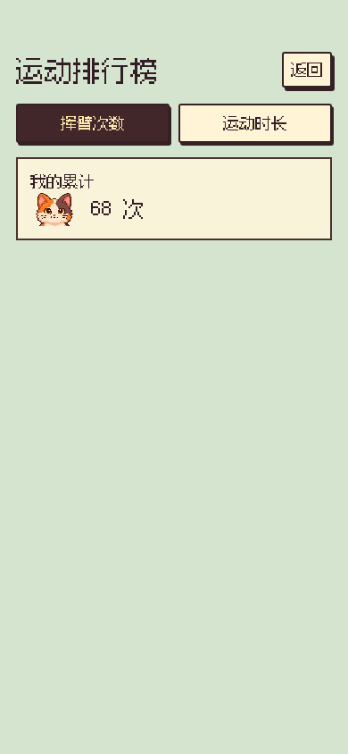

# Paws Up to No Good · 贱JIAN猫

**A camera-tracked desk-break pixel mini-game where you raise your hands and cause cat mischief.**  
**坐久了，来当只坏猫——举起双手就能玩的工位体感像素小游戏。**

**[Xiaohongshu Demo & Devlog / 小红书玩法演示帖子 →](https://www.xiaohongshu.com/discovery/item/6b0114a9000000002b006f82?source=webshare&xhsshare=pc_web&xsec_token=YBiRvzGYTkvC9auin5_qwPBqU1ULslkO9RsdQYe-O-XPk=&xsec_source=pc_share)**

---

## Overview / 项目简介

Sitting at a desk all day makes it hard to get yourself to stretch—unless the excuse is knocking lipsticks off a vanity table as a mischievous cat.

Prop your phone up in front of you, raise both hands, and each hand controls a cat paw in real time to swat, wipe, snatch, and pluck across 8 pixel scenes. All 8 stages also support direct touch controls.

在工位坐久了不想正经做操？那就化身坏猫来捣乱。把手机立在桌前、坐着举起双手，左右手各自实时控制一只猫爪去拨瓶子、擦窗户、抢零食、摘花瓣；同时八个关卡均完整支持触屏操作。

---

## Screenshots / 游戏画面

| Cover 封面 | Stage Select 选关 | Select a Cat 选只猫 | Vanity Table 梳妆台 | Receipt 结算小票 | Leaderboard 排行榜 |
| :---: | :---: | :---: | :---: | :---: | :---: |
|  |  |  |  |  |  |

---

## 8 Stages / 八个捣乱场景

1. **Vanity Table · 梳妆台** — Knock bottles, lipsticks, and cosmetics off the edge as items are placed onto the table.
2. **Foggy Window · 擦玻璃** — Swipe across steamed glass with live rain and city lights outside.
3. **Whipped Cream Cake · 抹奶油** — Smear freshly piped cream mounds across themed cakes.
4. **Balcony Bugs · 抓飞虫** — Catch darting insects flying in from off-screen at dusk.
5. **Cat Wand · 逗猫棒** — Grab swinging pendants across multi-wand waves and yank them loose.
6. **Hand Feeding · 接投喂** — Time your grab and snatch snacks back from a teasing human hand.
7. **Flower Petals · 摘花瓣** — Pluck petals off 6 swaying blossoms (with bonus balcony bugs).
8. **Space Station · 太空站** — Bat floating cargo through a moving camera-iris airlock in a spacesuit.

---

## 8 Unlockable Cats / 八只可解锁猫咪

Unlock a new cat after each clear—each with custom pixel front/back sprites, unique settlement titles, quips, and synthesized 8-bit meows:

- **Calico · 三花猫**
- **Tuxedo / Cow · 奶牛猫**
- **British Shorthair · 英国短毛猫**
- **Siamese · 暹罗猫**
- **Ragdoll · 布偶猫**
- **Maine Coon · 缅因猫**
- **Persian · 波斯猫**
- **Sphynx · 斯芬克斯猫**

---

## How It Works / 体感原理

- **On-device pose estimation / 本地端侧姿态识别**: Runs **MoveNet SinglePose Lightning** locally via **TensorFlow.js** (WebGL F16 with automatic CPU fallback). It tracks elbow-to-wrist vectors from the front camera to project left and right cat paws, with hysteresis confidence thresholds for reliable tracking even in sleeves or close desk framing. No camera video is ever uploaded to any server.
- **Desk micro-workout receipt / 工位微运动小票**: Tracks active seconds, swipes, and stretches per round, generating a shareable pixel receipt card alongside local and platform leaderboards.

---

> **Note / 说明**: This repository serves as a public project showcase and devlog pointer. The game source code is maintained privately.  
> 本仓库为项目公开展示页与开发记录入口，游戏源码保存在私有仓库中。
