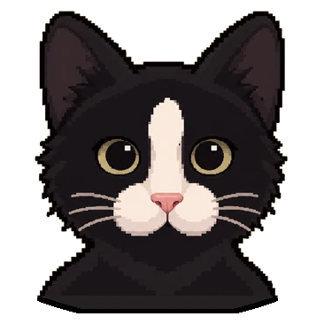
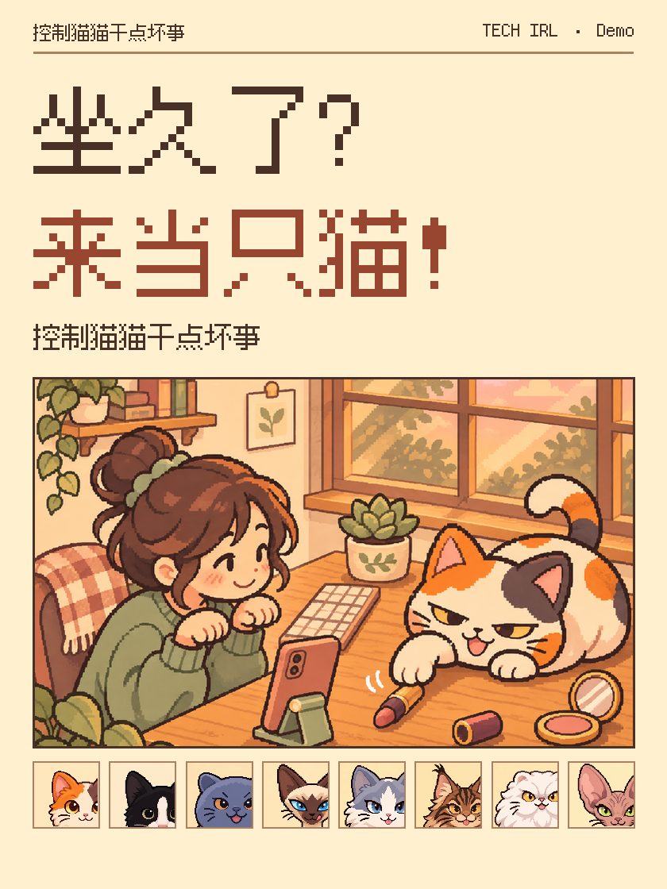
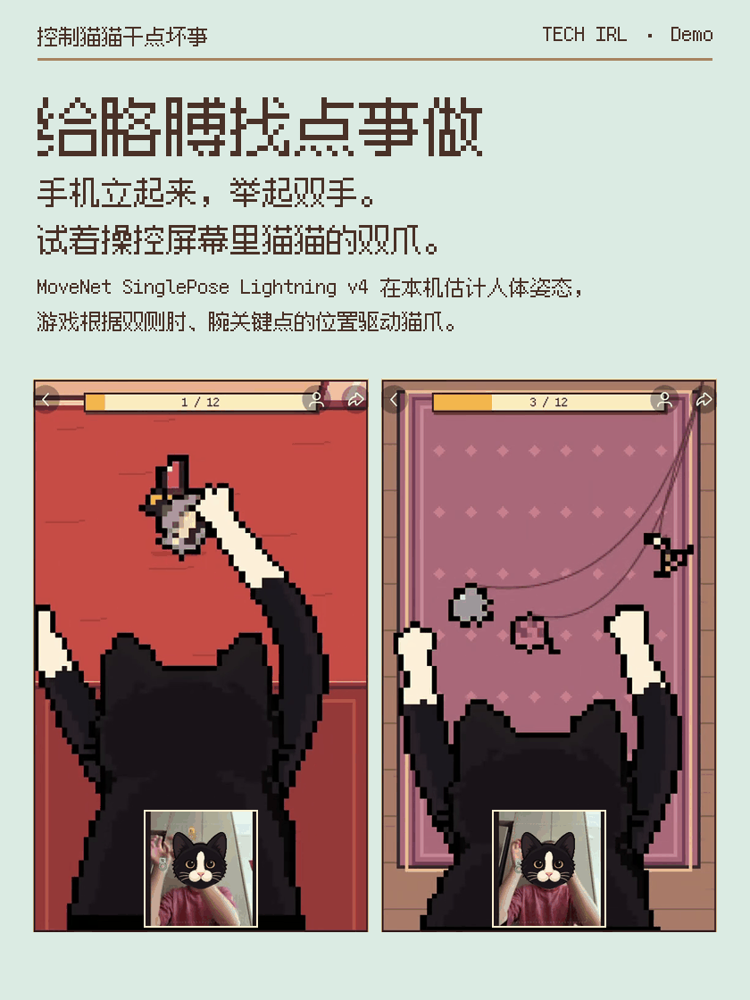
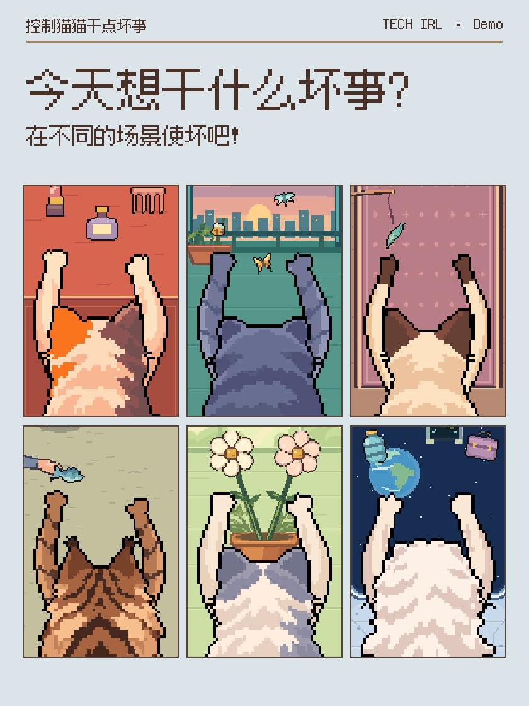
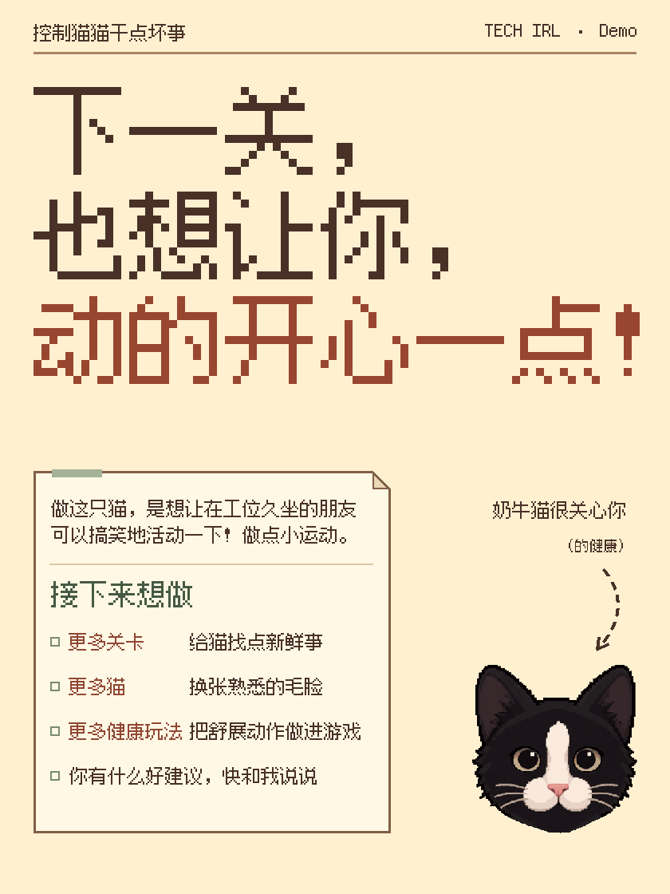
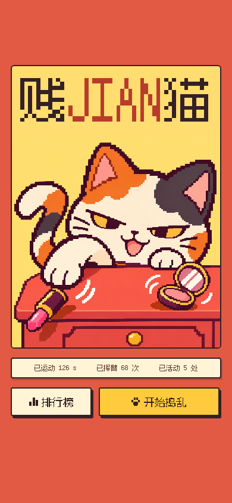
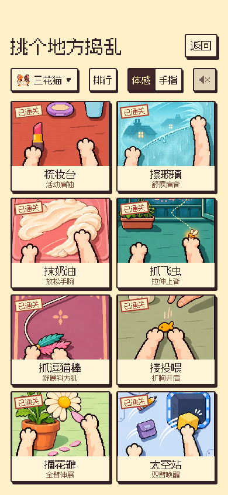

# Paws Up to No Good

A camera-tracked desk-break pixel mini-game where you raise your hands and cause cat mischief.

[Xiaohongshu Demo & Devlog →](https://www.xiaohongshu.com/discovery/item/6b0114a9000000002b006f82?source=webshare&xhsshare=pc_web&xsec_token=YBiRvzGYTkvC9auin5_qwPBqU1ULslkO9RsdQYe-O-XPk=&xsec_source=pc_share)

---

## Overview

Built as an excuse to get my hands off the keyboard after sitting at a desk too long. Tell me to do a stretch and I will probably say "later"—tell me I can be a mischievous cat knocking lipsticks off a vanity table, and suddenly I am in.

Prop your phone up in front of you and raise both hands: each hand drives one cat paw in real time, so one paw can pretend to be innocent while the other bats a bottle off the edge. All eight stages also support touch controls—just try not to let your coworkers catch you flailing at thin air.

在工位坐久了，总想找个理由把手从键盘上拿开。叫我正经活动一下，大概只会说“等会儿”；但要是能当只坏猫，把梳妆台边上的口红拨到地上——这我乐意。把手机立在桌前、坐着举起双手，左右手各管一只猫爪：一只装乖，另一只已经把瓶子拍走了（八个关卡也都支持直接触屏玩，就是别被同事当成在对着空气抽风）。

 

---

## Xiaohongshu Post

| 01 | 02 | 03 | 04 |
| :---: | :---: | :---: | :---: |
|  |  |  |  |

---

## Screenshots

| Cover | Stage Select | Select a Cat | Vanity Table | Receipt | Leaderboard |
| :---: | :---: | :---: | :---: | :---: | :---: |
|  |  |  |  |  |  |

---

## 8 Stages

1. **Vanity Table** — Knock lipsticks, perfume bottles, and cosmetics off the edge as items are placed onto the table.
2. **Foggy Window** — Swipe across steamed glass with live rain and city lights outside.
3. **Whipped Cream Cake** — Smear freshly piped cream mounds across themed cakes.
4. **Balcony Bugs** — Catch darting insects flying in from off-screen at dusk.
5. **Cat Wand** — Grab swinging pendants across multi-wand waves and yank them loose.
6. **Hand Feeding** — Time your grab and snatch snacks back from a teasing human hand.
7. **Flower Petals** — Pluck petals off 6 swaying blossoms (with bonus balcony bugs).
8. **Space Station** — Bat floating cargo through a moving camera-iris airlock in a spacesuit.

---

## 8 Unlockable Cats

Unlock a new cat after each clear—each with custom pixel front/back sprites, unique settlement titles, quips, and synthesized 8-bit meows:

Calico · Tuxedo · British Shorthair · Siamese · Ragdoll · Maine Coon · Persian · Sphynx

---

## How It Works

- **On-device pose tracking**: Runs **MoveNet SinglePose Lightning** locally in the browser via **TensorFlow.js** (WebGL F16 with automatic CPU fallback). It locates both elbows and wrists from the front camera, then projects slightly forward along each forearm to estimate palm position—keeping tracking steady even in sleeves or close desk framing. No camera video ever leaves the device.
- **Desk micro-workout receipt**: Logs active seconds, arm swipes, and stretches per round, generating a shareable pixel receipt card alongside local and platform leaderboards.

---

> **Note**: This repository is a public project showcase. The game source code is maintained privately.
